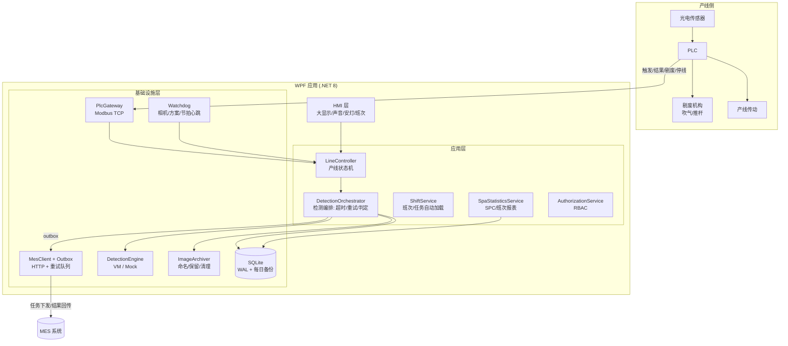
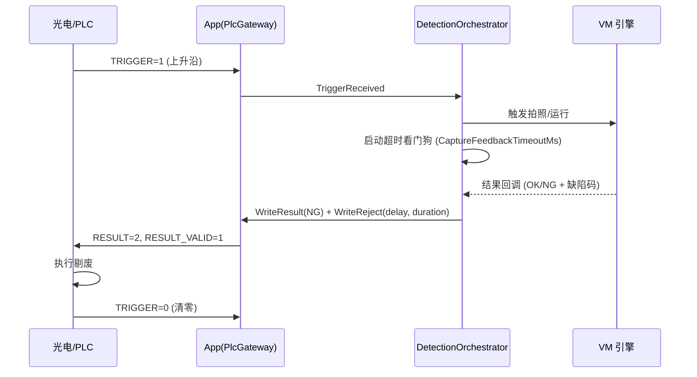
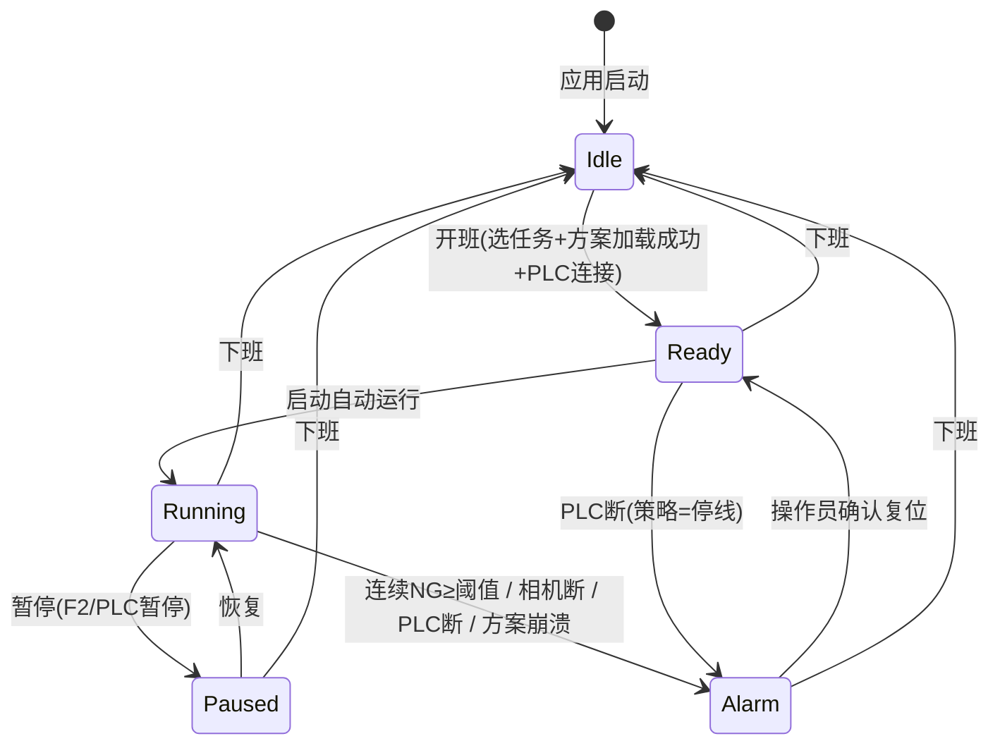

# Triple-Detection 生产级改造设计

> **文档版本:** v1.0
> **更新日期:** 2026-11-01
> **状态:** 设计评审中
> **关联代码:** 以 `TripleDetection.csproj`（net8.0-windows / C# 12）为准；`CLAUDE.md` 中 ".NET Framework 4.8 + C# 8.0" 的描述已过时，需在 Phase 0 一并修正

---

## 1. 背景与目标

### 1.1 现状评估

本项目是包装线"三期"（批号 BN / 生产日期 Mfg / 有效期 EXP）OCR 检测系统。检测内核已完整：**任务 → 加载 .sol 方案 → 三期 ToVM → OCR 运行 → 结果解析 → DetectionRecord 入库 → 图像归档**。

但对照实际工厂产线要求，**"产线集成层"基本缺失**：

| # | 缺口 | 现状证据 | 影响 |
|---|------|---------|------|
| G1 | 无 PLC/IO 通信 | `CommunicationSettings.PlcIp/PlcPort/PlcType` 只存不用，全项目无 Modbus/OPC/Socket 代码 | 检测靠人工点按钮，无法与产线联动 |
| G2 | 无剔废/停线逻辑 | `DeviceControlSettings.RejectDelayMs/RejectDurationMs/ConsecutiveRejectsToStopLine` 只存不用 | NG 品无法自动剔除，连续故障无人知晓 |
| G3 | 生产流程全手工 | `DetectionView`：选任务→加载方案→设三期→点运行，全部人工 | 开班/换型效率低，易漏步骤 |
| G4 | 无 MES 集成 | 三期期望值人工填在任务表单 | 期望值可能填错；结果无法回传追溯 |
| G5 | 结果协议脆弱 | `VmIntegrationService.ParseResult` 逗号分隔字符串，无版本、无超时、无缺陷分类 | 字段错位静默出错；NG 无法归因 |
| G6 | 异常被吞、无崩溃恢复 | 回调内 `catch → Debug.WriteLine`；根目录存在 3 个 `PlatformSDK-*.dmp` | 故障不可见；SDK 崩溃后检测停摆 |
| G7 | 追溯信息不全 | `DetectionRecord` 无 NG 原因/操作员/工位；图像文件名仅时间戳 | 质量追溯断链（食品/药品行业不合规） |
| G8 | 数据治理未实现 | `SystemSettings.ImageRetentionCount/AutoCleanImages/DbBackupRoot` 字段有、代码无 | 磁盘无限增长；数据无备份 |
| G9 | 权限未落地 | `User.Role` 字段存在，无任何 RBAC 检查 | 操作员可改方案/参数 |
| G10 | 统计能力弱 | Dashboard 仅今日 OK/NG 计数 + 最近 10 条 | 无良率趋势、无 NG Pareto、无班次统计 |
| G11 | 无部署/自愈 | 无安装包、无看门狗、无优雅退出 | 应用崩溃后产线继续跑但无人检测（最危险场景） |
| G12 | 单相机单工位 | 单 `IDetectionEngine` 实例 | 无法支持顶视+侧视多相机 |

### 1.2 目标

1. **产线无人化**：光电触发 → 自动检测 → 自动剔废/停线，运行期无需人工干预。
2. **数据可信**：每件产品可追溯（人、机、料、批号、图像、NG 原因），满足食品/药品行业数据完整性要求。
3. **故障可见可恢复**：所有异常有告警、有记录、有自动恢复路径。
4. **可运维**：一键安装、崩溃自愈、参数变更受控、统计报表支撑质量改进。

### 1.3 非目标

- 不替换 VisionMaster（方案引擎、OCR 算法保持 VM 实现，仅约定接口）。
- 不做多工位集中管理（单 PC 单工位；多工位通过部署多实例解决）。
- 不做实时 MES 双向实时同步（任务下发为班次粒度，结果回传为异步准实时）。

### 1.4 设计原则

- **硬件全部走接口 + Mock 实现**：延续 `MockDetectionEngine` 模式，PLC/相机/MES 均有 Mock，无硬件环境可跑通全链路。
- **检测主路径零阻塞**：MES 回传、图像清理、备份等一律后台异步（outbox 模式），不得卡检测节拍。
- **配置驱动**：PLC 寄存器表、超时、阈值全部可配置，不硬编码。
- **向后兼容**：结果协议 v1（CSV）保留，v2（JSON）增量升级，VM 方案可分步改造。

---

## 2. 总体架构

### 2.1 目标架构图



### 2.2 新增代码位置

```
Infrastructure/
├── Device/
│   ├── IPlcGateway.cs              # PLC 抽象
│   ├── PlcRegisterMap.cs           # 寄存器表（配置驱动）
│   ├── ModbusTcpPlcGateway.cs      # Modbus TCP 实现
│   ├── MockPlcGateway.cs           # 模拟 PLC（开发/演示）
│   └── CameraHealthMonitor.cs      # 相机/方案心跳监控
├── Mes/
│   ├── IMesClient.cs
│   ├── HttpMesClient.cs
│   └── OutboxProcessor.cs          # 后台重试发送
Application/
├── Line/
│   ├── LineState.cs                # 状态枚举
│   ├── ILineController.cs
│   ├── LineController.cs           # 状态机 + 停线策略
│   └── ShiftService.cs             # 班次/任务加载/换型
├── VmServices/
│   ├── IResultParser.cs            # 协议解析器注册
│   ├── V1CsvResultParser.cs        # 现有格式（保留）
│   ├── V2JsonResultParser.cs       # 新协议
│   └── DetectionWatchdog.cs        # 单次检测超时看门狗
Domain/
├── Entities/  (扩展 DetectionRecord；新增 Shift、OutboxMessage、NgReason)
```

---

## 3. 模块设计

### 3.1 M1 — PLC/IO 通信层（P0）

**接口定义：**

```csharp
public interface IPlcGateway
{
    bool IsConnected { get; }
    event EventHandler<PlcTriggerEventArgs> TriggerReceived;   // 产品到位
    event EventHandler<RecipeChangeEventArgs> RecipeChanged;   // 换型信号
    event EventHandler PlcDisconnected;

    Task ConnectAsync(CancellationToken ct);
    Task DisconnectAsync();
    Task WriteResultAsync(DetectionVerdict verdict, CancellationToken ct);   // OK/NG + 缺陷码
    Task WriteRejectCommandAsync(int delayMs, int durationMs, CancellationToken ct);
    Task WriteLineStopAsync(int alarmCode, CancellationToken ct);
    Task WriteStationStatusAsync(int status, CancellationToken ct);
}
```

**寄存器表（Modbus TCP，holding register，待电气确认）：**

| 寄存器 | 方向 | 名称 | 说明 |
|--------|------|------|------|
| 40001 | PLC→App | `TRIGGER` | 1 = 产品到位（上升沿触发） |
| 40002 | PLC→App | `RECIPE_CHANGE` | 1 = 换型请求 |
| 40003 | PLC→App | `RECIPE_ID` | 产品/配方 ID（映射 Product.Code） |
| 40004 | PLC→App | `LINE_SPEED` | 线速（剔废延迟补偿用） |
| 40011 | App→PLC | `RESULT` | 0=空闲 1=OK 2=NG |
| 40012 | App→PLC | `RESULT_VALID` | 结果有效标志（PLC 读后清零） |
| 40013 | App→PLC | `REJECT_CMD` | 1 = 执行剔废（脉冲） |
| 40014 | App→PLC | `LINE_STOP` | 1 = 停线请求 |
| 40015 | App→PLC | `ALARM_CODE` | 报警码（安灯显示） |
| 40016 | App→PLC | `STATION_STATUS` | 0=空闲 1=运行 2=报警 |

**握手时序：**



**关键行为：**

- **心跳与重连**：500ms 轮询；断连 → 指数退避重连（1s/2s/4s…上限 30s）；重连期间状态机降级 `Alarm`（策略可配：停线 or 转手动模式）。
- **触发防抖**：连续触发间隔 < 最小节拍（可配，默认 500ms）视为毛刺，丢弃并计数告警。
- **超时处理策略**（可配 `OnCaptureTimeout`）：`TreatAsNG`（默认，安全侧）/ `Ignore` / `StopLine`。
- **驱动选型**：Modbus TCP 优先（三菱/西门子/欧姆龙均支持）；`IPlcGateway` 预留 OPC UA 实现位。Modbus 协议用轻量自实现或 NModbus4（.NET 8 兼容，待 Phase 1 评估许可证）。

### 3.2 M2 — 产线状态机与生产自动化（P0）

**状态机：**



**状态转换规则表（节选）：**

| 当前态 | 事件 | 目标态 | 动作 |
|--------|------|--------|------|
| Running | 连续 NG ≥ `ConsecutiveRejectsToStopLine` | Alarm | 写 LINE_STOP + ALARM_CODE=1001 + 声音告警 |
| Running | 相机心跳丢失 > N 秒 | Alarm | ALARM_CODE=2001（相机离线） |
| Running | 检测超时 | 保持 Running | 计 NG（Timeout），连续超时≥3 → Alarm |
| Alarm | 操作员复位 | Ready | 清 ALARM，记录 AuditLog |

**班次与自动加载（ShiftService）：**

1. **开班**：操作员登录 → 选择当班任务（或从 MES 拉取当日任务）→ 自动加载对应产品 `.sol` → 自动写入三期 ToVM → 状态机进入 `Ready`。
2. **自动运行**：操作员按 F1（或 HMI 大按钮）→ `Running`，此后 PLC 触发驱动检测，无人值守。
3. **换型**：收到 `RECIPE_CHANGE` → 按 `RECIPE_ID` 查 `Product.Code` → 查该产品已审批任务 → 暂停 → 加载新方案 + 新三期 → 自动恢复（可配"换型需人工确认"）。
4. **下班**：停止自动运行 → 生成本班次统计 → 状态机 `Idle`。

### 3.3 M3 — 检测引擎健壮性（P1）

**3.3.1 结果协议 v2（JSON，版本化）**

VM 方案输出串约定：

```json
{
  "v": 2,
  "ok": false,
  "bn":  { "expected": "20260901", "actual": "20260902", "match": false },
  "mfg": { "expected": "202609-01", "actual": "2026-09-01", "match": true },
  "exp": { "expected": "2027-09-01", "actual": null,        "match": false },
  "confidence": 0.92,
  "msg": "批号不匹配; 有效期漏印"
}
```

解析器注册（`IResultParser`，按 `v` 字段/首字符自动路由）：

```csharp
public interface IResultParser
{
    int Version { get; }
    bool TryParse(string raw, out DetectionResultV2 result);
}
// V1CsvResultParser: 现有 "1,批号,日期,有效期" 格式，保留兼容
// V2JsonResultParser: 新 JSON 格式
```

> VM 方案侧需同步改造 OCR 输出节点（输出 JSON 串）。Phase 0 先落 App 侧解析与数据模型，VM 方案改造可并行，未改造前走 v1。

**3.3.2 缺陷分类（NG 归因）**

```csharp
public enum NgReason
{
    None = 0,
    BnMismatch = 1,    MfgMismatch = 2,   ExpMismatch = 3,
    BnMissing = 10,    MfgMissing = 11,   ExpMissing = 12,
    OcrFailed = 20,    Timeout = 21,      ImageQuality = 22,
    Other = 99
}
```

v1 协议下 NG 无法细分时记 `Other`（`NgDetail` 存原始串）；v2 下精确归因。多缺陷并存时取优先级最高者，全部存入 `NgDetail`。

**3.3.3 超时看门狗（DetectionWatchdog）**

- 每次触发启动独立计时（`CaptureFeedbackTimeoutMs`，默认 5000ms）。
- 超时 → 合成 `Timeout` NG 结果（走正常入库/剔废路径）+ 超时计数。
- 连续超时 ≥ 3 → 触发状态机 Alarm（相机或方案卡死）。

**3.3.4 健康检查（CameraHealthMonitor）**

| 监控对象 | 手段 | 阈值（可配） | 动作 |
|----------|------|-------------|------|
| 相机出图 | VM 采集模块帧计数/时间戳 | 运行中 30s 无新帧 | Alarm 2001 |
| VM 方案 | `OnWorkStatusEvent` 错误状态 | 任意崩溃 | 自动重载方案（≤2 次），失败 → Alarm 2002 |
| 检测节拍 | 触发到结果耗时 P99 | > 2× 历史均值 | 日志告警（性能退化预警） |

**3.3.5 崩溃恢复**

- **VM 层**：`VmIntegrationService` 订阅方案崩溃事件 → 自动 `LoadSolution` 重载 → 恢复自动运行（次数上限，超限 Alarm）。
- **App 层**：外部看门狗（见 M9）重启进程；应用重启后状态机从 `Idle` 起，需人工开班（安全侧，避免重启后带着旧任务状态直接跑线）。
- **数据层**：SQLite 开 WAL + `busy_timeout`；MES 未发结果经 outbox 补发，不丢数据。

**3.3.6 异常治理**

- 禁止 `catch → Debug.WriteLine` 吞异常（现有 `VmIntegrationService` 回调、`ImageStorageService` 均需整改）。
- 统一 `AppExceptionHandler`：未处理异常 → 写 `error.log`（带堆栈+上下文）→ 状态机 Alarm → 弹窗（非运行态）。

### 3.4 M4 — MES 集成（P1）

**接口：**

```csharp
public interface IMesClient
{
    Task<IReadOnlyList<MesTaskDto>> DownloadTasksAsync(string lineCode, DateTime date, CancellationToken ct);
    Task UploadResultAsync(MesResultReportDto report, CancellationToken ct);
}
```

**接口约定（REST/JSON，与 MES 团队确认）：**

- `GET /api/station/tasks?line=L001&date=2026-11-01`
  → `[{ taskId, productCode, batchNumber, mfgDate, expDate, planQuantity }]`
- `POST /api/station/results`
  → `{ stationCode, taskId, batchNumber, ok, ngReason, imageRef, elapsedMs, operatorId, detectedAt }`

**Outbox 模式（关键）：**

```
检测结果 → 写 DetectionRecord + 写 OutboxMessages(状态=Pending) → 立即返回
后台 OutboxProcessor: 每 5s 扫描 Pending → 发送 → 成功=Sent / 失败=RetryCount++
  重试: 指数退避 10s/30s/2min/10min/30min，5 次后进 DeadLetter 并告警
```

- 检测主路径**绝不**等待 MES；MES 宕机不影响产线。
- 开班拉任务失败 → 允许人工建任务兜底，界面明确提示"MES 离线"。

### 3.5 M5 — 数据追溯与治理（P1）

**3.5.1 DetectionRecord 扩展**

| 新字段 | 类型 | 说明 |
|--------|------|------|
| `NgReason` | int (enum) | 缺陷分类，OK 时为 0 |
| `NgDetail` | text | 缺陷明细（v2 的 msg / v1 原始串） |
| `OperatorId` | int | 当班操作员（开班时确定） |
| `StationCode` | text | 工位码（来自 SystemSettings.FactoryCode+ProductionLine） |
| `CameraId` | text | 默认 `CAM1`，为多相机预留 |
| `Confidence` | real | OCR 置信度（v2 提供） |
| `SequenceNo` | int | 当班顺序号（追溯定位用） |

**3.5.2 图像命名与归档（ImageArchiver 重构）**

现命名 `yyyyMMdd_HHmmss_fff_OK.png` → 新命名：

```
{yyyyMMdd_HHmmss_fff}_{StationCode}_{TaskId}_{Batch}_{Seq:000000}_{OK|NG}.png
例: 20261101_101530_123_L001_7_20260901_000123_NG.png
```

- 目录结构按日期分层：`Images/{yyyyMMdd}/{OK|NG}/`（利于清理与检索）。
- 保存失败**必须**记日志 + 计数（现有 `Debug.WriteLine` 整改点）。

**3.5.3 保留与清理（后台任务，每日 02:00）**

| 对象 | 策略（默认，可配） |
|------|-------------------|
| OK 图像 | 保留 30 天 或 总量 ≤ `ImageRetentionCount` |
| NG 图像 | 保留 180 天（追溯需要，长于 OK） |
| 日志 | 现有 `LogRetentionDays`（已实现，保留） |
| 数据库 | 每日 `VACUUM INTO` 备份至 `DbBackupRoot`，保留 14 份 |

- 清理任务写 `AuditLog`（谁/何时/删了什么/多少张），满足审计要求。

### 3.6 M6 — RBAC 权限落地（P2）

**角色与权限矩阵：**

| 功能 | Operator | Engineer | Admin |
|------|:---:|:---:|:---:|
| 检测（查看/启动/暂停/复位） | ✓ | ✓ | ✓ |
| 开班/下班 | ✓ | ✓ | ✓ |
| 任务创建/编辑/审批 | ✗ | ✓ | ✓ |
| 产品管理 | ✗ | ✓ | ✓ |
| 参数设置（PLC/设备/系统） | ✗ | ✓ | ✓ |
| 用户管理 | ✗ | ✗ | ✓ |
| 审计日志查看 | ✗ | ✓ | ✓ |
| 审计日志导出/删除 | ✗ | ✗ | ✓ |
| 数据库备份/恢复 | ✗ | ✗ | ✓ |

**实现：**

- `IAuthorizationService.Can(User user, Action action) → bool`，Action 枚举化（`Detection.Run`, `Task.Approve`, `Settings.Modify`…）。
- 双层执行：ViewModel 层隐藏/禁用入口（体验）+ Service 层强制校验（安全，防绕过）。
- 所有越权尝试写 `AuditLog`。
- 现有 `User.Role` 字符串值规范化为 `Role` 枚举（`Operator/Engineer/Admin`）。

### 3.7 M7 — SPC 与班次统计（P2）

**指标：**

| 指标 | 粒度 | 用途 |
|------|------|------|
| 良率 | 小时/班次/日 | 趋势监控 |
| NG Pareto | 班次/日（按 NgReason 聚合） | 定位主要缺陷 |
| OCR 置信度 | 班次（均值/P5） | 识别"低置信度通过"风险 |
| 检测耗时 | 班次（P50/P99） | 性能退化预警 |
| 良率控制图 | 小时点 + 3σ 上下限 | 过程失控报警 |

**视图：**

- `SpaView`：良率趋势折线 + NG Pareto 柱状（图表库选 LiveCharts2，WPF 原生、MIT 许可）。
- `ShiftReportView`：班次报表（起止时间、操作员、总数、OK/NG、良率、NG 明细 Top、停机时长与原因），支持导出 CSV。
- 数据来源：`DetectionRecords` 聚合查询（SQLite 单机量级足够；按 `DetectionTime` 建索引）。

### 3.8 M8 — 车间 HMI（P2）

- **大显示模式**（F11 切换）：检测结果 100pt+ 大字、全屏绿/红背景，3m 外可读。
- **声音**：OK 短鸣 1 声；NG 长鸣 2 声（连续 NG 音调升级）；可配静音/音量。
- **安灯**：复用 PLC 输出寄存器 40015 报警码（电气侧显示）。
- **免鼠标**：F1 启动/停止、F2 暂停/恢复、F3 复位报警；HMI 大按钮布局。

### 3.9 M9 — 部署与自愈（P2/P3）

| 项 | 方案 |
|----|------|
| 安装包 | Inno Setup：应用 + 依赖检测（VM SDK 版本校验）+ 开机自启 + 桌面/开始菜单快捷方式 |
| 看门狗 | Windows 服务（.NET 8 Worker Service，随包安装）：30s 检查进程 → 崩溃自动拉起 → 写 `watchdog.log`；连续 3 次崩溃/小时 → 写故障标志（下次启动弹窗提示） |
| 优雅退出 | `App.OnExit`：停自动运行 → 保存运行状态（班次未结束则提示）→ flush DB → 释放 VM 资源 |
| 时间同步 | 启动时 NTP 校时（`w32tm /stripazure` 或 HTTP NTP）；偏移 > 5s → 开班前强制告警（追溯时间戳可信前提） |
| 单实例 | 现有 Mutex 保留 |

### 3.10 M10 — 多相机扩展（P3，预留）

- `IDetectionEngine` 注册表化：`IEngineRegistry.Get(cameraId)`；`DetectionOrchestrator` 支持并行触发 N 个引擎。
- 判定策略可配：`AllOK`（默认，任一 NG 即 NG）/ `Majority`。
- `DetectionRecord.CameraId` 已预留（3.5.1）。
- 本阶段**不改接口签名**，仅确认 `DetectionResult` 携带 `CameraId` 即可平滑扩展。

---

## 4. 数据模型变更

### 4.1 新表

```sql
CREATE TABLE Shifts (
    Id INTEGER PRIMARY KEY AUTOINCREMENT,
    StartAt TEXT NOT NULL, EndAt TEXT,
    OperatorId INTEGER NOT NULL, TaskId INTEGER NOT NULL,
    LineCode TEXT NOT NULL,
    TotalCount INTEGER NOT NULL DEFAULT 0, OkCount INTEGER NOT NULL DEFAULT 0,
    NgCount INTEGER NOT NULL DEFAULT 0, StopDurationMs INTEGER NOT NULL DEFAULT 0,
    IsDeleted INTEGER NOT NULL DEFAULT 0,
    CreateAt TEXT NOT NULL, UpdateAt TEXT NOT NULL, CreateBy TEXT, UpdateBy TEXT
);

CREATE TABLE OutboxMessages (
    Id INTEGER PRIMARY KEY AUTOINCREMENT,
    Topic TEXT NOT NULL,              -- 'DetectionResult'
    Payload TEXT NOT NULL,            -- JSON
    Status INTEGER NOT NULL DEFAULT 0,-- 0=Pending 1=Sent 2=DeadLetter
    RetryCount INTEGER NOT NULL DEFAULT 0,
    NextRetryAt TEXT,
    CreatedAt TEXT NOT NULL, SentAt TEXT
);
CREATE INDEX IX_Outbox_Status ON OutboxMessages(Status, NextRetryAt);
```

### 4.2 现有表变更

```sql
ALTER TABLE DetectionRecords ADD COLUMN NgReason INTEGER NOT NULL DEFAULT 0;
ALTER TABLE DetectionRecords ADD COLUMN NgDetail TEXT;
ALTER TABLE DetectionRecords ADD COLUMN OperatorId INTEGER;
ALTER TABLE DetectionRecords ADD COLUMN StationCode TEXT;
ALTER TABLE DetectionRecords ADD COLUMN CameraId TEXT NOT NULL DEFAULT 'CAM1';
ALTER TABLE DetectionRecords ADD COLUMN Confidence REAL;
ALTER TABLE DetectionRecords ADD COLUMN SequenceNo INTEGER;
CREATE INDEX IX_Detection_Time ON DetectionRecords(DetectionTime);
CREATE INDEX IX_Detection_Batch ON DetectionRecords(BatchNumber, DetectionTime);
```

### 4.3 迁移机制（新增）

现有 `DatabaseInitializer` 用 `CREATE TABLE IF NOT EXISTS`，无法演进。引入轻量版本迁移：

- 新表 `SchemaMigrations (Version INTEGER PRIMARY KEY, AppliedAt TEXT)`。
- 迁移脚本按版本号顺序执行（`ALTER TABLE ... ADD COLUMN` 前先查 `PRAGMA table_info` 判存在，保证幂等）。
- 启动时自动应用未执行版本；失败 → 阻止启动并明确报错（生产系统不允许半迁移状态）。

---

## 5. 关键配置项（SystemConfigs 表，Category 分组）

| Category | Key | 默认 | 说明 |
|----------|-----|------|------|
| Plc | Ip / Port / UnitId | 192.168.1.200 / 502 / 1 | Modbus TCP 连接 |
| Plc | RegisterMap | 见 3.1 表 | 寄存器地址（JSON，可配） |
| Plc | OnDisconnect | StopLine | StopLine / ManualMode |
| Detection | CaptureTimeoutMs | 5000 | 单次检测超时 |
| Detection | OnCaptureTimeout | TreatAsNG | TreatAsNG / Ignore / StopLine |
| Detection | MinTriggerIntervalMs | 500 | 触发防抖 |
| Reject | DelayMs / DurationMs | 50 / 200 | 剔废时序（含线速补偿） |
| Reject | ConsecutiveNgToStopLine | 10 | 连续 NG 停线阈值 |
| Retention | OkImageDays / NgImageDays | 30 / 180 | 图像保留 |
| Retention | DbBackupKeep | 14 | 备份保留份数 |
| Mes | BaseUrl / LineCode / Enabled | — / L001 / false | MES 开关与地址 |
| Hmi | SoundEnabled / BigDisplay | true / false | HMI 行为 |

---

## 6. 分阶段实施计划

| 阶段 | 内容 | 交付物 | 验收标准 | 预估 |
|------|------|--------|----------|------|
| **Phase 0** 基础 | 结果协议 v2 解析 + NgReason 枚举 + DetectionRecord 字段扩展 + 迁移机制 + 图像新命名 + 异常治理整改 + 修正 CLAUDE.md | 可构建、Mock 全链路通过 | ① v1/v2 解析单测全过 ② 旧库启动自动迁移成功 ③ 新图像命名生效 ④ 无 `catch→Debug` 残留 | 1 周 |
| **Phase 1** 产线集成 | IPlcGateway + ModbusTcp 实现 + MockPlc + 状态机 + 自动触发 + 剔废/停线 + 超时看门狗 | Mock 环境可模拟完整产线节拍 | ① Mock PLC 触发→检测→剔废全链路无人工 ② 断连/连续 NG 正确停线 ③ 超时按策略处理 | 2-3 周 |
| **Phase 2** 健壮性+数据治理 | 相机/方案健康检查 + 崩溃自动恢复 + 图像清理 + DB 备份 + 班次实体 | 可 7×24 无人值守试运行 | ① 杀 VM 进程后自动恢复 ② 磁盘占用收敛 ③ 备份可恢复 | 2 周 |
| **Phase 3** MES+班次 | IMesClient + Outbox + 开班自动加载 + 换型 + 班次报表 | Mock MES 联调通过 | ① MES 宕机不影响检测 ② 断网结果补发 ③ 换型自动切方案 | 2 周 |
| **Phase 4** 权限+统计+HMI | RBAC 双层执行 + SPC 视图 + 班次报表导出 + 大显示/声音 | 三角色账号权限矩阵测试通过 | ① Operator 无法改参数 ② Pareto/趋势图正确 ③ 大显示模式可用 | 2 周 |
| **Phase 5** 部署+多相机 | Inno Setup + 看门狗服务 + 优雅退出 + NTP + 多相机预留验证 | 干净 Windows 机器一键部署 | ① 杀进程 30s 内自愈 ② 多相机并行判定正确 | 持续 |

**依赖关系**：Phase 0 → 1 → 2 → 3 → 4 串行；Phase 5 的部署部分可与 Phase 3/4 并行。

---

## 7. 测试策略

| 层 | 手段 |
|----|------|
| 单元 | 协议解析器（v1/v2/畸形输入）、状态机全转换、剔废延迟计算、RBAC 矩阵、Outbox 重试逻辑（xUnit） |
| 集成 | `MockPlcGateway`（模拟触发/换型/断连）+ `MockDetectionEngine` + 临时 SQLite 全链路 |
| 离线回放 | 保存触发时刻图像 → 重放进 VM 方案 → 回归验证方案改动（Phase 2 提供工具） |
| 现场 | 真 PLC 联调（寄存器表需电气确认后冻结，见风险 R2） |

Mock PLC 行为脚本化（JSON 描述：t=0s 触发、t=2s 换型、t=5s 断连…），保证回归可复现。

---

## 8. 风险与开放问题

| # | 风险/问题 | 影响 | 对策 |
|---|----------|------|------|
| R1 | VM 方案侧需同步输出 v2 JSON | 不改造则 NG 无法细分归因 | 协议双版本兼容；方案改造与 Phase 0 并行，不阻塞 |
| R2 | PLC 寄存器表为建议值，需电气团队确认 | 联调返工 | Phase 1 启动前冻结寄存器表；`RegisterMap` 可配置降低改动面 |
| R3 | 剔废时序依赖线速/机械响应 | NG 品剔错位置 | `LINE_SPEED` 寄存器 + 现场标定；剔废参数可配 |
| R4 | SQLite 并发写（检测+Outbox+备份） | 写锁竞争 | WAL + `busy_timeout=5000`；备份用 `VACUUM INTO`（不锁读）；量级评估：单机 10 件/s 足够 |
| R5 | .NET 8 WPF 在车间 PC 的兼容性（显卡驱动/VM SDK） | 部署失败 | Phase 5 前在目标机型验证；保留 .NET Framework 回退选项（成本较高，最后手段） |
| R6 | 无硬件环境无法验证真实节拍 | 上线延期 | Mock 全链路 + 现场联调窗口前置预约 |
| R7 | 食品/药品合规（ALCOA+/21 CFR Part 11）深度要求 | 审计风险 | 本设计已覆盖审计轨迹/防删除/备份；若客户为 GxP 环境，Phase 4 后追加电子签名模块 |

---

## 9. 附录：与现有代码的映射

| 现有代码 | 改造动作 |
|----------|----------|
| `VmIntegrationService.ParseResult` | 提取为 `V1CsvResultParser`，新增 `V2JsonResultParser` |
| `VmIntegrationService` 回调内吞异常 | 接入 `AppExceptionHandler` + 状态机 Alarm |
| `DetectionView`（手动按钮流） | 保留为"手动调试模式"（Engineer 权限），新增 HMI 自动运行模式 |
| `MockDetectionEngine` | 保留；新增 `MockPlcGateway`、`MockMesClient` 同模式 |
| `ImageStorageService` | 重构为 `ImageArchiver`（新命名/日期分层/失败告警） |
| `SystemSettings` 未用字段 | 全部落到 `SystemConfigs` 配置项（第 5 节），实现对应行为 |
| `DatabaseInitializer` | 升级为版本化迁移（4.3） |
| `User.Role` 字符串 | 规范化为枚举 + `AuthorizationService` |
| `DashboardView` | 扩展 SPC 指标 + 班次统计入口 |
| `CLAUDE.md` | 修正技术栈描述（net8.0 / C# 12 / 单项目 DDD 分层） |
