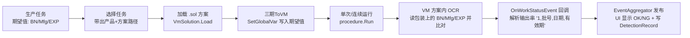
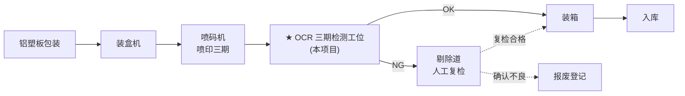
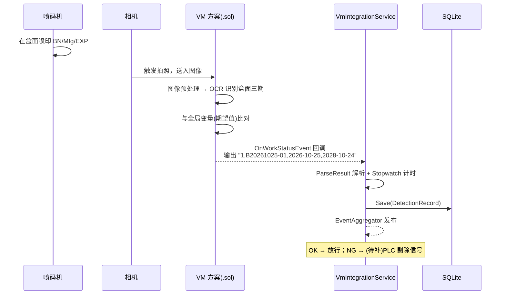

# Triple-Detection 项目讲解

> 基于 **WPF + Prism + 海康 VisionMaster SDK（纯 API 路线）** 的包装线"三期"OCR 检测系统
> 源码来源：[liumalu/Triple-Detection](https://github.com/liumalu/Triple-Detection)（Apache-2.0）
> 本地路径：`E:\study\简历\project\非实验室\Triple-Detection`

---

## 1. 业务：包装线"三期"OCR 校验

**"三期" = 批号（Batch Number, BN）+ 生产日期（Mfg）+ 有效期（EXP）**。

这是食品/药品/化妆品包装产线上的典型工位：包装喷码后，相机拍包装，**OCR 读出印在包装上的三期信息，与 MES/生产任务下发的期望值比对**——印错、漏印、日期不符即 NG。



**证据链**（代码里的硬证据）：

| 证据 | 位置 |
|------|------|
| 结果解析 `ParseResult`：`"1, 20260901, 2026-09-01, 2027-09-01"` → OK/NG + 三期 | `VmIntegrationService.cs` |
| 交互按钮 "三期ToVM" / "三期FromVM"，读写 `BN`/`Mfg`/`EXP` 全局变量 | `DetectionView.xaml.cs` |
| 默认方案 `D:\xcm\ApplicationDemo\OCRDemoCs\OCRDemoChinese.sol`（VM 自带中文 OCR 示例） | `CLAUDE.md` |
| `DetectionRecord` 实体：BatchNumber / ProductionDate / ExpirationDate / IsOK | `Domain/Entities/DetectionRecord.cs` |

---

## 2. 技术栈

| 类别 | 技术 | 说明 |
|------|------|------|
| 运行时 | **.NET 8.0-windows** | SDK-style csproj，x64，C# 12（`LangVersion 12.0`） |
| UI 框架 | WPF | 单解决方案多文件夹分层（非多项目） |
| MVVM 框架 | **Prism 9.0.537 (DryIoc)** | Region 导航 + EventAggregator + 容器 |
| ORM | **EF Core 8 + SQLite** | `TripleDetectionDbContext`，库文件 `Data\tripledetection.db` |
| 视觉 SDK | VisionMaster（VM.Core / VM.PlatformSDKCS / VMControls.WPF+Winform） | 海康 VM 4.x |
| 日志 | 自研 `LoggingService`（文件 + 事件推送 UI） | 非 NLog |

> ⚠️ **文档与代码不同步**：仓库 `docs/` 和 `CLAUDE.md` 写的是 ".NET Framework 4.8 + EF6 + 多项目（App/Services/Data）"，那是**重构前**的状态。实际代码已重构成 net8.0 + EF Core + DDD 四层（见提交历史 `ddd-four-layer-refactor`）。**读代码以 csproj 和源码为准，docs 当设计参考。**

---

## 3. 目录结构（DDD 四层，单项目内按文件夹分）

```
Triple-Detection/
├── Domain/                        # 领域层（纯 POCO，不依赖任何框架）
│   ├── Entities/                  # User / Product / ProdTask / DetectionRecord
│   │                              # SystemConfig / AuditLog + 分页查询对象
│   ├── Repositories/              # 仓储接口 IRepository<T> / IUnitOfWork / 工厂
│   ├── Enums/                     # TaskStatus / ProductStatus / ValidType ...
│   └── SessionManager.cs          # 当前登录用户会话
│
├── Application/                   # 应用层（业务编排）
│   ├── Services/                  # Product/Task/User/DetectionRecord/AuditLog 服务
│   ├── SettingsServices/          # 通信/设备/系统/VM 四类配置服务
│   └── VmServices/
│       ├── VmIntegrationService.cs  # ★ VM SDK 封装（全项目核心）
│       ├── ImageStorageService.cs   # 图像存 OK/NG 目录
│       └── SettingsSyncService.cs   # 把 PLC/相机配置同步进 VM 全局变量
│
├── Infrastructure/                # 基础设施层
│   ├── Persistence/               # EF Core DbContext + SQLite 连接/事务
│   ├── Repositories/              # SqliteRepository<T> 等实现
│   ├── libs/                      # ★ VM DLL 大部分打包在此（相对路径引用）
│   └── Exceptions/                # 自定义异常
│
├── Presentation/                  # 表现层（WPF）
│   ├── App.xaml(.cs)              # PrismApplication：DI 注册 + 单实例 + 登录
│   ├── Views/                     # Login / Detection / Dashboard / Products /
│   │                              # Tasks / Logs / Settings / UserMgmt / AuditLog
│   ├── ViewModels/                # 对应 VM（Auth/Detection/Production/Settings）
│   ├── Events/                    # EventAggregator 事件定义
│   ├── Models/                    # DetectionResult / 各 Settings 模型
│   └── Converters/                # 值转换器
│
├── docs/superpowers/plans+specs/  # ★ 18 篇 AI 辅助开发的设计/计划文档
├── build.bat / build_output.txt   # 构建脚本与输出
└── PlatformSDK-*.dmp              # ⚠️ 3 个 VM SDK 崩溃 dump（作者调试残留）
```

---

## 4. 启动流程（Prism 生命周期）

```csharp
public partial class App : PrismApplication
{
    // ① 单实例 Mutex + 数据库初始化
    protected override void OnStartup(StartupEventArgs e)
    {
        _mutex = new Mutex(true, "TripleDetectionApp_SingleInstance", out bool createdNew);
        if (!createdNew) { MessageBox.Show("应用程序已在运行中。"); Shutdown(); return; }
        InitializeDatabase();          // 建 Data\ 目录 + EF Core 建表
        base.OnStartup(e);
    }

    // ② DI 注册（全量手工注册，见下）
    protected override void RegisterTypes(IContainerRegistry containerRegistry) { ... }

    // ③ Shell
    protected override Window CreateShell() => Container.Resolve<MainWindow>();

    // ④ 先登录，登录成功才显示主窗口
    protected override void OnInitialized()
    {
        var loginWindow = new LoginWindow();
        if (loginWindow.ShowDialog() != true) { Shutdown(); return; }
        MainWindow.Show();
    }
}
```

DI 注册要点（`RegisterTypes`）：

- **数据层**：`SqliteConnectionFactory` / `SqliteRepositoryFactory` 注册为实例；`IRepository<>` 泛型仓储 transient
- **服务层**：全部 transient；`VmIntegrationService` **singleton**（VM 方案全局只加载一份）
- **VM**：9 个 View 用 `RegisterTypeForNavigation<...>("Dashboard"/"Detection"/...)` 注册为 **Prism Region 导航**目标
- **MainWindow** singleton

---

## 5. 核心：VM 集成（`VmIntegrationService`）

这是全项目最值得读的文件（约 250 行），走的是**纯 SDK 深集成路线**：

```csharp
public class VmIntegrationService
{
    public event EventHandler<DetectionResult> OnDetectionResult;

    // 加载方案：Load + 取第一个流程
    public void LoadSolution(string solPath)
    {
        VmSolution.Load(solPath);
        ProcessInfoList list = VmSolution.Instance.GetAllProcedureList();
        _procedure = VmSolution.Instance[list.astProcessInfo[0].strProcessName] as VmProcedure;
    }

    // 触发运行（单次）
    public void RunOnce() { _stopwatch.Restart(); _procedure?.Run(); }

    // 连续运行开关
    public void SetContinuousRun(bool enable) => _procedure.ContinuousRunEnable = enable;

    // 三期传参：写 VM 全局变量（方案里必须有 "全局变量1" 模块）
    public void SetGlobalVariableString(string name, string value)
    {
        var gvTool = VmSolution.Instance["全局变量1"] as GlobalVariableModuleTool;
        gvTool?.SetGlobalVar(name, value);
    }

    // ★ 回调：VM 工作线程触发，解析结果
    private void VmSolution_OnWorkStatusEvent(IMVS_MODULE_WORK_STAUS info)
    {
        if (info.nWorkStatus == 0 && info.nProcessID == 10000)   // 流程执行完成
        {
            _stopwatch.Stop();
            var ioInfos = _procedure.ModuResult.GetAllOutputNameInfo();
            var str = _procedure.ModuResult.GetOutputString(ioInfos[0].Name);
            var result = ParseResult(str.astStringVal[0].strValue);
            result.ElapsedMs = _stopwatch.ElapsedMilliseconds;

            _eventAggregator?.GetEvent<DetectionResultEvent>().Publish(result); // 事件总线
            OnDetectionResult?.Invoke(this, result);                            // 传统事件

            // 落库（异常吞噬，不阻塞检测）
            _detectionRecordService?.Save(new DetectionRecord { ... });
        }
    }

    // 输出串协议： "1, 20260901, 2026-09-01, 2027-09-01"
    internal static DetectionResult ParseResult(string str) { ... }
}
```

**要点**：

1. **结果协议是"约定字符串"**——VM 方案最后一个模块必须输出 4 段逗号分隔字符串（`OK标志,批号,生产日期,有效期`），C# 侧 `Split(',')` 解析。方案与上位机靠**字符串协议**通信，这是 VM 二次开发最常见的做法
2. **回调在 VM 工作线程**，UI 更新靠 `Dispatcher.Invoke`（见 `DetectionView.VmService_OnDetectionResult`）
3. **双通道通知**：`EventAggregator`（Prism 事件总线，新）+ `EventHandler`（旧，兼容）——重构过渡期的痕迹
4. **耗时统计**：`Stopwatch` 从 `Run()` 到回调，写入 `ElapsedMs`
5. **任务上下文**：`SetCurrentTaskContext(taskId, productId, batchNumber)` 让回调落库时知道结果属于哪个任务/产品

### 检测页交互（`DetectionView.xaml.cs`）

注意：这个 View **绕过 DI 手工 new 服务**（构造函数里 `new SqliteRepositoryFactory()` / `new VmIntegrationService(...)`），是重构未彻底完成的痕迹，学习时知道即可，别照抄。

| 按钮 | 行为 |
|------|------|
| 选择方案 / 加载方案 | 文件对话框选 `.sol` → `LoadSolution` → 创建 `VmRenderControl`（WinForms 控件经 `WindowsFormsHost` 嵌入），`ModuleSource = _procedure` 绑定渲染 |
| 保存方案 | `VmSolution.Save` |
| 三期ToVM | 把任务的 BN/Mfg/EXP 写入 VM 全局变量 |
| 三期FromVM | 从 VM 全局变量读回（调试用） |
| 单次运行 | `RunOnce()` |
| 连续运行/停止 | `SetContinuousRun(true/false)` |

结果 UI：OK/NG 大字 + 颜色、OK/NG 计数、合格率、最近 100 条检测日志。

---

## 6. 数据模型（EF Core + SQLite）

```mermaid
erDiagram
    Product ||--o{ ProdTask : "一个产品多个任务"
    ProdTask ||--o{ DetectionRecord : "一个任务多次检测"
    User ||--o{ AuditLog : "操作留痕"

    Product {
        string Code
        string Name
        string SolFilePath "★ 产品绑定 .sol 方案路径"
        ValidType ValidType "年/月/天"
        int ValidPeriod
    }
    ProdTask {
        string Name
        int ProductId
        TaskStatus Status "Pending→Approved 审批流"
        string BatchNumber
        DateTime ProductionDate
        DateTime? ExpirationDate
        string CreatedBy / ReviewedBy
    }
    DetectionRecord {
        int TaskId / ProductId
        string BatchNumber
        bool IsOK
        string ProductionDate / ExpirationDate
        string ImagePath
        long ElapsedMs
        DateTime DetectionTime
    }
```

- `BaseEntity`：Id / CreateBy / UpdateBy / CreateAt / UpdateAt / IsDeleted（软删除）
- 分页查询：`PagedQuery` / `IPagedResult` 通用分页
- 审计：`AuditLog` 记录用户操作（登录、增删改）
- 用户：`User` 实体 + `PasswordHashService`（密码哈希，不是明文）

---

## 7. Prism 知识点对照

| 知识点 | 位置 |
|--------|------|
| `PrismApplication` 四钩子（OnStartup/RegisterTypes/CreateShell/OnInitialized） | `App.xaml.cs` |
| 单实例 Mutex | `App.OnStartup` |
| **Region 导航**：`RegisterTypeForNavigation<T>("Name")` + 9 个 View | `App.xaml.cs` + `MainWindow` |
| **EventAggregator**：`DetectionResultEvent` / `LogEvents` / `NavigationEvents` | `Presentation/Events/` |
| DryIoc 容器：瞬态/单例/实例注册、泛型仓储 | `App.RegisterTypes` |
| `BindableBase` + `SetProperty` | 各 VM |
| `DelegateCommand` | 各 VM |
| 值转换器（登录按钮文字、Tab 可见性） | `Presentation/Converters/` |
| 登录门禁（`OnInitialized` 里 ShowDialog，失败即 Shutdown） | `App.xaml.cs` |

---

## 8. 配置体系（Settings）

四类配置，各自一个 Service + View：

| 配置 | 内容 | 特殊点 |
|------|------|--------|
| 通信设置 | 相机 IP/端口、**PLC IP/端口/类型（三菱/西门子/欧姆龙）/波特率** | `SettingsSyncService` 把 PLC 参数**写入 VM 全局变量**（`PLC_IP`/`PLC_PORT`/`PLC_TYPE`/`PLC_BAUD`）→ 推测 VM 方案内用 PLC 模块做通信 |
| 设备控制 | 设备相关参数 | — |
| 系统设置 | 全局参数 | — |
| VM 设置 | VM 相关 | — |

> 注意：C# 侧**没有** Modbus/串口通信库，PLC 实际通信（如果有的话）是在 VM 方案内部完成的——C# 只负责把参数"喂"给方案。

---

## 9. 编译运行

### 前置

1. 安装海康 **VisionMaster 4.2.0**（默认路径 `C:\Program Files\VisionMaster4.2.0`）
2. Visual Studio 2022（17.8+，支持 .NET 8）

### 依赖引用方式（比 RunVision 友好）

- 大部分 VM DLL 已打包在 `Infrastructure\libs\`（**相对路径**，clone 即用）
- 一部分 COM 控件 DLL 引用 `$(VmInstallPath)` = `C:\Program Files\VisionMaster4.2.0\Development\V4.x\...` → **必须本机装 VM 4.2.0**，路径不同就改 csproj 里的 `VmInstallPath` 属性（只需改一处）
- NuGet：`Prism.DryIoc` + `EFCore.Sqlite`，自动还原

### 运行

1. 打开 `TripleDetection.sln`，平台 **x64**，F5
2. 首次启动：自动建 `Data\tripledetection.db` + 初始数据
3. 登录（初始账号看 `DatabaseInitializer` / 种子数据）
4. 产品管理里给产品配 `.sol` 路径（或检测页手动选）
5. 检测页：选任务 → 加载方案 → 三期ToVM → 单次运行

### .sol 从哪来

仓库**不含 .sol**。用 VM 自带的 OCR 示例：`C:\Program Files\VisionMaster4.2.0\ApplicationDemo\OCRDemoCs\OCRDemoChinese.sol`（注意需改造：输出模块要按 `OK,批号,日期,有效期` 的 4 段逗号协议输出，且方案里要有名为"全局变量1"的全局变量模块接收 BN/Mfg/EXP）。

---

## 10. 已知问题 / 重构残留（学习时注意）

1. **docs 与代码脱节**：架构文档写 .NET 4.8/EF6/多项目，实际是 net8.0/EF Core/单项目 DDD 分层——以代码为准
2. **`DetectionView` 绕过 DI**：构造函数里手工 `new` 仓储和服务，与 `App` 里的容器注册并存，两条路都能走（设计文档里也承认"DetectionView 直接调用 VM API，耦合高"是待解决问题）
3. **存图没接通**：`ImageStorageService.SaveImage` 定义了但**全项目无调用点**（设计文档里是注释掉的 `result.ImagePath = _imageStorage.SaveImage(...)`）→ `DetectionRecord.ImagePath` 实际是空的
4. **触发是手动的**：没有 PLC 信号驱动的自动循环（设计文档里 PLC/IO 剔除是 P2 计划，未实现）
5. **仓库卫生**：3 个 `PlatformSDK-*.dmp` 崩溃 dump、`error.log`、`build_output.txt` 都提交进来了
6. **双事件通道**：EventAggregator + EventHandler 并存，属过渡期写法
7. **`nProcessID == 10000` 硬编码**：回调里写死了流程 ID 判断，换方案可能不触发（10000 是 VM 流程完成的约定 ID，但耦合在代码里不优雅）

---

## 11. 与其他项目对比 & 学习路径

| 维度 | RunVision | **Triple-Detection** | MicroplateScanner |
|------|-----------|----------------------|-------------------|
| 业务 | PCB 拼板 AOI | 包装三期 OCR | 微孔板细胞团判定 |
| 视觉 | VM 方案（.sol） | VM 方案（.sol, OCR） | 自研 Python+OpenCV |
| VM 集成 | 浅（嵌 VmFrontendControl） | **深（Run+回调+解析）** ✅ | 不用 VM |
| 数据 | config.json | EF Core + SQLite ✅ | SQLite |
| 触发 | 无（设计给 PLC） | 手动按钮 | 全自动（机台蛇形扫描） |
| 框架 | .NET 4.8 + Prism | net8.0 + Prism ✅ | net10 + CommunityToolkit.Mvvm |

**学习顺序建议**：

1. **精读 `VmIntegrationService.cs`**（半天）——VM 深集成的完整样本：Load → SetGlobalVar → Run → 回调 → 解析 → 落库
2. **读 `App.xaml.cs`**（1 小时）——Prism 单实例 + 登录门禁 + Region 导航注册 + DI 全景
3. **读 `DetectionView.xaml.cs`**（2 小时）——业务如何把"任务/产品/方案/渲染/运行"串起来（注意区分哪些是重构残留）
4. **翻 `docs/superpowers/specs/`**——18 篇设计文档是难得的"需求→设计→实现"全留档，尤其 `2026-05-29-vm-parameter-passing-design.md` 把 VM 参数传递的演进讲得很清楚
5. **练手补空白**（由易到难）：
   - 接通存图：回调里取 VM 图像 → `ImageStorageService.SaveImage` → 填 `DetectionRecord.ImagePath`
   - 把 `nProcessID == 10000` 硬编码改成从方案读取
   - 加 PLC 触发：引入 NModbus4，读"到位"信号 → `RunOnce` → 写"检测完成"，把手动闭环变成自动闭环
   - 清理 `DetectionView` 的手工 new，统一走 DI

---

## 12. 完整业务场景设计（场景模拟）

> 下面用一个**具体到人和时间点**的场景，把系统所有功能串成一条真实产线故事。
> 场景基于项目现有功能设计，标注了哪些已实现、哪些需要补齐。

### 12.1 场景背景

- **企业**：某制药厂（GMP 认证），药品包装车间
- **产品**：健胃生片（0.4g × 48 片/盒），有效期 2 年
- **产线**：包装二线，节拍 **40 盒/分钟**（约 1.9 万盒/8 小时班）
- **GMP 要求**：包装上的批号/生产日期/有效期必须与生产指令一致，全程可追溯



### 12.2 角色与权限（对应 `User` 实体）

| 角色 | 账号 | 职责 | 对应功能 |
|------|------|------|---------|
| 计划员 | planner01 | 创建生产任务（录入批号/日期） | 任务管理（TaskEditWindow） |
| 质检员 | qa01 | **审批任务**（防止错批号上线） | 任务审批流（Pending → Approved） |
| 线体操作员 | op01 | 运行检测工位、处理 NG | 检测页（DetectionView） |
| 系统管理员 | admin | 用户管理、设备/通信配置、查审计 | 用户管理 / 设置 / 审计日志 |

> 权限设计意图：**录入和审批分离**（计划员录的批号必须质检员确认），操作员只能跑"已审批"的任务——这是 GMP 数据完整性（防错批）的基本要求。

### 12.3 一天的工作流（时间线）

```
07:30  操作员 op01 登录（密码哈希校验，审计日志记录登录）
07:35  计划员创建任务：
         产品     = 健胃生片（产品档案里已绑定 健胃生片.sol）
         批号     = B20261025-01
         生产日期 = 2026-10-25
         有效期   = 2028-10-24   ← 可由 ValidType=Year, ValidPeriod=2 自动推算
         状态     = Pending
07:40  质检员核对批号与生产指令单一致 → 点"审批" → 状态变 Approved
07:45  操作员在检测页下拉框选任务
         （代码只列出 Approved 的任务 → 未审批的根本选不到）
         界面带出：产品名 / 批号 / 生产日期 / 有效期 / 方案路径
07:46  操作员点"加载方案"（VmSolution.Load）
       → 点"三期ToVM"（把期望值写入 VM 全局变量 BN/Mfg/EXP）
07:50  点"连续运行" → 产线开始，每盒自动检测
10:00  换批：计划员创建 B20261025-02 并审批
       操作员选新任务 → 三期ToVM 更新期望值 → 继续跑
       （★ 若喷码机还喷着旧批号，比对立刻 NG，错误当场暴露 ★）
16:30  下班：查看统计
         今日 19,200 盒 | OK 19,152 | NG 48 | 合格率 99.75%
16:35  操作员退出，审计日志记录当班全部操作（登录/选任务/运行/退出）
```

### 12.4 一盒药的完整旅程（时序）



**结果协议**（方案输出模块必须遵守）：`OK标志,批号,生产日期,有效期`，逗号分隔 4 段，如 `1,B20261025-01,2026-10-25,2028-10-24`。

### 12.5 异常场景与处理

| 异常 | 原因 | 系统行为 | 人工处理 |
|------|------|---------|---------|
| 漏喷码 | 墨尽/喷嘴堵 | OCR 读不到 → NG | 查喷码机，补喷后复检 |
| 喷码模糊 | 包材褶皱/油污 | 识别置信度低 → NG | 人工复核，判真 NG/误判 |
| **喷错批号** | 换批操作失误，旧批还在喷 | 比对不一致 → NG（★本系统核心价值★） | 停线，排查换批流程 |
| 有效期录错 | 计划员笔误 | 比对不一致 → NG | 改任务、重新审批 |
| 相机故障 | 镜头脏/断线 | 无图/异常 → 日志报警 | 报修 |
| VM 方案异常 | SDK 崩溃 | try-catch + 日志（仓库里的 .dmp 就是这种） | 重载方案 |

> 设计思想：**系统只负责"发现不一致"，判定权留给人**——NG 走剔除道人工复检，避免误剔造成浪费。

### 12.6 追溯场景（客户投诉响应）

> 2027-03，某医院反馈："一批健胃生片有效期印成 2027-10-24，疑似临期药。"

质量部用本系统 10 分钟定位：

1. **检测历史**按批号 `B20261025-01` 查 → 该批 2026-10-25 07:50–10:00 共 6,000 盒，全部记录在 `DetectionRecord`
2. 找到投诉盒的条码对应记录：OCR 识别结果、期望值、OK/NG、耗时、（补图后）现场图像
3. **审计日志**回答"人"的问题：谁创建的任务、谁审批的、当班操作员是谁
4. 结论示例：系统记录显示当时有效期期望值 = 识别值 = 2028-10-24，该盒 OK 放行 → 问题出在下游物流混批，而非产线

> 这就是"每次检测都落库"的业务意义：**产线当时发生了什么，事后可以完整重放。**

### 12.7 场景 ↔ 项目功能映射（总表）

| 场景步骤 | 项目功能 | 状态 |
|---------|---------|------|
| 登录/登出 | LoginWindow + User + PasswordHashService | ✅ 已实现 |
| 创建任务（批号/日期） | TaskEditWindow + ProdTask | ✅ 已实现 |
| 任务审批（防错批） | TaskStatus.Pending → Approved | ✅ 已实现 |
| 产品绑定方案 | Product.SolFilePath | ✅ 已实现 |
| 只允许选已审批任务 | DetectionView.LoadTasks 过滤 | ✅ 已实现 |
| 三期传参给 VM | SetGlobalVariableString(BN/Mfg/EXP) | ✅ 已实现 |
| OCR 检测 | `.sol` 方案（需按 4 段协议搭建） | ⚠️ 需搭方案 |
| 结果解析/显示/统计 | ParseResult + UpdateDetectionResult | ✅ 已实现 |
| 检测记录落库 | DetectionRecord + EF Core | ✅ 已实现 |
| 检测历史查询 | DetectionHistoryView | ✅ 已实现 |
| 操作审计 | AuditLog + AuditLogView | ✅ 已实现 |
| 相机/PLC 参数配置 | CommunicationSettings + SettingsSyncService（同步进 VM 全局变量） | ✅ 已实现 |
| **NG 剔除（PLC/IO）** | 设计文档 P2 计划 | ❌ 未实现 |
| **NG 图像归档** | ImageStorageService（已写未接） | ⚠️ 未接通 |
| 有效期自动推算 | ValidType/ValidPeriod 字段已有，逻辑未写 | ⚠️ 可补 |
| 声光报警/大屏 | 无 | ❌ 未实现 |

### 12.8 把场景跑通的补齐清单（按优先级）

1. **搭 OCR 方案（.sol）**：图像输入 → OCR 模块（读 BN/Mfg/EXP）→ 比对模块 → 字符串输出（4 段逗号协议）+ "全局变量1" 模块接收期望值。可用 VM 自带 `OCRDemoChinese.sol` 改造
2. **PLC/IO 闭环**：引入 NModbus4 —— 读光电"到位"信号触发 `RunOnce`，NG 时写剔除阀信号（把手动按钮变成自动产线）
3. **接通 NG 存图**：回调里取 VM 输出图像 → `ImageStorageService.SaveImage` → 回填 `DetectionRecord.ImagePath`（追溯场景第 2 步依赖它）
4. **有效期自动推算**：创建任务时按 `ValidType + ValidPeriod` 自动算 ExpirationDate，减少计划员笔误
5. **报警**：连续 N 盒 NG 或相机无图 → 弹窗 + 声音报警，提示停线

---

*文档生成于 2026-10-25，基于本地源码（提交 `42aed50`）逐文件阅读整理。*
